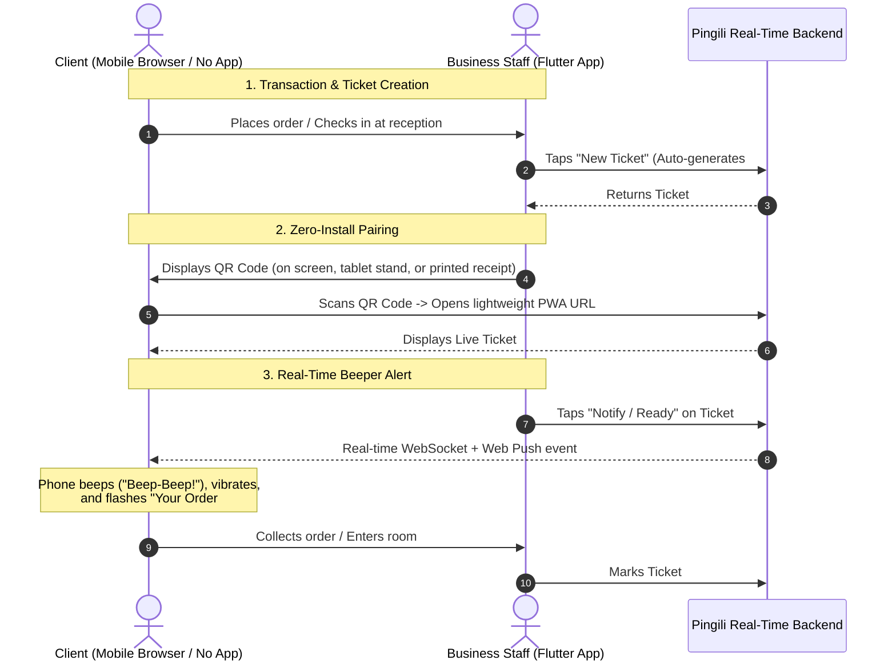
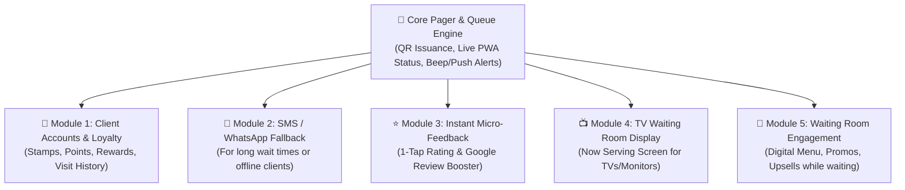
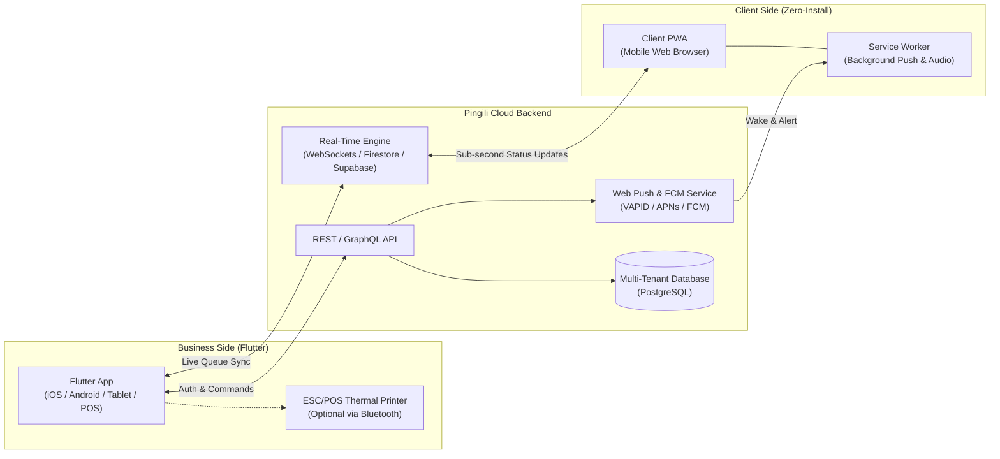

# Pingili — Universal Digital Pager & Queue Notification Platform
**High-Level Product Requirements Document (PRD)**

---

## 1. Executive Summary & Vision

**Pingili** is a universal, multi-industry digital pager and virtual queue notification platform. It replaces physical restaurant buzzers, paper tickets, and crowded waiting rooms with an instant, zero-friction digital workflow.

- **The Core Promise for Clients:** **Zero App Installation.** Clients simply scan a dynamic QR code presented by the business, opening a lightweight Progressive Web App (PWA) directly in their mobile browser that displays their live ticket status and alerts them (via sound, vibration, and push notifications) the moment their turn or order is ready.
- **The Core Promise for Businesses:** **Turnkey & Modular.** Businesses download the **Pingili Business App (built with Flutter)**, set up their workspace in under two minutes, choose their industry workflow (Restaurant, Car Wash, Medical Clinic, Retail, etc.), and immediately begin issuing and managing tickets. As their needs grow, they can enable plug-and-play modules such as **Client Loyalty Programs**, **SMS/WhatsApp Fallbacks**, and **Customer Feedback**.

---

## 2. Target Industries & Use Cases

Because Pingili abstracts the concept of a "Ticket" and "Status Pipeline", the exact same engine adapts across verticals through configurable presets:

| Industry / Vertical | Ticket Entity | Typical Status Workflow | Notification Trigger |
| :--- | :--- | :--- | :--- |
| **Restaurants, Cafes & Food Trucks** | Order / Table | `Preparing` → `Ready for Pickup` → `Completed` | Cashier/Kitchen taps "Ready" — Client phone beeps & vibrates like a physical coaster pager. |
| **Car Washes & Auto Detailing** | Vehicle / Service | `Queued` → `Washing` → `Drying/Detailing` → `Car Ready` | Attendant updates stage — Client can grab a coffee nearby and gets alerted when the car is ready. |
| **Medical & Dental Waiting Rooms** | Patient Visit | `Checked In` → `Next in Line` → `Call to Room X` | Assistant calls patient — Patient waits in their car or a quiet area until buzzed with the room number. |
| **Pharmacies, Bakeries & Delis** | Counter Ticket | `Waiting` → `Now Serving` | Staff advances the queue — Eliminates crowded counters and missed numbers. |
| **Repair Shops & Dry Cleaners** | Drop-off Item | `Received` → `In Progress` → `Ready for Collection` | Technician marks complete — Triggers Web Push or SMS/WhatsApp link for same-day or multi-day pickup. |

---

## 3. End-to-End Core Workflow

---

## 4. Platform Components & Functional Requirements

### 4.1. Client Web Application (Zero-Install PWA)
The client experience must load in under 1.5 seconds on 4G connections and require **no account creation** and **no app store download** for the core paging flow.

1. **Instant Ticket View:**
   - Displays Business Logo, Name, and Brand Colors.
   - Displays large, high-contrast **Ticket Number / Identifier** (e.g., `#042`, `Plate: AB-123-CD`, or `Dr. Smith - Room 3`).
   - Shows live status badge, progress bar (for multi-step workflows like Car Wash), and estimated wait time or queue position (optional per business).
2. **Multi-Layer Alerting Engine ("The Beeper"):**
   - **Audio Alert:** Plays a distinct, repeating chime/beep (`beep-beep`) using the Web Audio API (unlocked upon the client's initial tap/interaction on the page).
   - **Haptic Alert:** Triggers rhythmic device vibration via the Navigator Vibration API (on supported devices).
   - **Visual Alert:** Full-screen high-visibility flashing banner when the status changes to `Ready / Called`.
   - **Background Web Push Notifications:** Uses Service Workers and the Web Push API (supported on Android Chrome and iOS 16.4+ Safari/Web Apps) so the client still gets alerted if they lock their phone or switch to another app.
   - **Screen Wake Lock:** Utilizes the Screen Wake Lock API to optionally keep the screen dimmed but awake while waiting in short-queue environments (e.g., fast food).
3. **"I'm On My Way" / Acknowledgment Button:**
   - Allows the client to tap **"Got it / Coming!"** to silence the repeating alarm and let the cashier know the client has seen the alert.
4. **Optional Post-Scan Modules (Non-Intrusive):**
   - While waiting, the client sees subtle cards below their ticket: *"Join [Business Name] Loyalty Club to earn 10 points for this visit"*, digital menu/catalog browsing, or Wi-Fi connection details.

---

### 4.2. Business Application (Flutter — iOS, Android, Tablet, Web/Desktop POS)
Built with **Flutter** from a single codebase so businesses can run it on a cashier's smartphone, a counter-top Android/iPad tablet, or a POS terminal.

1. **Self-Service Business Onboarding:**
   - Sign up via Phone Number (OTP), Google, or Apple ID.
   - **Business Profile Setup:** Name, Logo, Brand Color, and **Industry Template Selection** (Restaurant, Car Wash, Clinic, Custom).
   - **Workflow Customization:** Customize ticket prefixes, status steps (1-step instant ready vs. multi-step progress), and alert messages.
2. **Ticket Issuance & QR Presentation:**
   - **One-Tap Ticket Creation:** Auto-incrementing ticket numbers (`#001` to `#999` with daily reset) or custom input (Customer Name, License Plate, Receipt Number).
   - **QR Code Display Modes:**
     - **On-Screen Modal:** Cashier flips or shows phone/tablet screen for the client to scan.
     - **Customer-Facing Secondary Display Mode:** A dedicated second device/tablet facing the customer that automatically shows the QR code whenever the cashier creates a ticket.
     - **Thermal Printer Integration (Bluetooth/ESC-POS):** Prints a tiny physical slip with the QR code and ticket number.
     - **Static "Self-Claim" QR Mode (Advanced):** A fixed QR sticker on the counter; the client scans it and enters their receipt number or waits for the cashier to approve the pairing request.
3. **Live Queue & Active Tickets Dashboard:**
   - Kanban or Grid view of active tickets grouped by status (`Waiting`, `In Progress`, `Notified/Ready`).
   - **Live Connection Indicator:** Shows a green dot on tickets where the client has scanned the QR code and is actively connected.
   - **One-Tap "Ping / Buzz" Action:** Changes status to `Ready` and triggers the client's alarm.
   - **"Re-Ping" Button:** If the client hasn't arrived after 2 minutes, staff can tap "Buzz Again" to send a follow-up alert.
4. **Multi-Staff & Multi-Device Sync:**
   - Multiple staff members can log into the same business workspace simultaneously (e.g., Cashier creates the ticket at the front; Kitchen or Car Wash bay marks it "Ready" from another device).
   - Role-based access: `Owner/Admin`, `Manager`, `Operator/Cashier`.

---

## 5. Modular Plugin Architecture (Value-Added Ecosystem)

Pingili is designed with a **Core Pager Engine** surrounded by **Optional Modules** that businesses can toggle on/off based on their subscription tier or industry needs.

### Module 1: Client Accounts & Loyalty / Fidelity Program (Priority Module)
- **Frictionless Upgrade:** A client never *needs* an account to get buzzed. However, on the waiting screen (or right after pickup), a prompt invites them: *"Save your stamp for today's visit! Sign in with 1 tap (Google / Apple / Phone OTP)."*
- **Loyalty Models Supported:**
  - **Digital Punch/Stamp Card:** e.g., *"Buy 9 coffees or car washes, get the 10th free."*
  - **Points-per-Visit or Points-per-Spend:** Cashier optionally enters the order amount when creating the ticket, or points are awarded per completed ticket.
- **Automatic Accrual:** Because the QR code is uniquely tied to a real transaction/ticket created by the cashier, the client automatically earns their loyalty point/stamp when that ticket is marked `Completed`—preventing fraud.
- **Client Wallet View:** Logged-in clients can view their active rewards across **all** Pingili-powered businesses they visit (creating a network effect where one Pingili client account works at their local cafe, car wash, and barber).
- **Redemption Flow:** When a client has a reward ready, their ticket shows a **"Redeem Reward"** badge on the cashier's Flutter app.

### Module 2: SMS & WhatsApp Fallback
- For services with long wait times (e.g., 2-hour car detailing, electronics repair), clients can optionally enter their phone number on the PWA screen to receive a WhatsApp message or SMS when their ticket is ready, in case they close their browser completely.

### Module 3: Post-Service Micro-Feedback & Google Reviews
- 5 minutes after a ticket is marked `Completed`, the PWA transitions to a 1-tap satisfaction rating (1 to 5 stars).
- If 4–5 stars: Prompts the client with a direct link to leave a Google Maps Review for the business.
- If 1–3 stars: Opens a private feedback form sent directly to the business owner's Flutter app to resolve the issue privately.

### Module 4: Waiting Room TV Display (Web Cast / Android TV)
- Businesses with physical waiting rooms (clinics, pharmacies, fast food) can open a dedicated TV URL that displays `In Progress` vs. `Now Serving` ticket numbers on a large screen, synced in real time with the Flutter app.

### Module 5: Waiting-Time Promotions & Digital Catalog
- Displays custom banners, daily specials, Wi-Fi passwords, or interactive menus on the lower half of the client's waiting screen to monetize attention while they wait.

---

## 6. Technical Architecture & Stack Recommendations

### 6.1. High-Level System Architecture

### 6.2. Key Technical Solutions for Reliability
1. **Solving Mobile Browser Background Restrictions (The "Beep-Beep" Challenge):**
   - Mobile browsers (especially iOS Safari and Android Chrome) block auto-playing audio unless initiated by a user gesture, and throttle background tabs.
   - **Solution A — Immediate User Gesture Unlock:** When the client scans the QR code, the landing screen presents a prominent **"Tap to Activate Live Beeper 🔔"** button. This single tap simultaneously:
     1. Unlocks the Web Audio API context (playing a short confirmation chime).
     2. Requests Web Push Notification permission (`Notification.requestPermission()`).
     3. Acquires a `navigator.wakeLock.request('screen')` lock so the phone doesn't sleep while on the table.
   - **Solution B — Heartbeat & Fallback Detection:** The PWA sends a lightweight WebSocket heartbeat to the backend. The cashier's Flutter app shows whether the client's screen is currently **Active (Green)**, **Backgrounded with Push Enabled (Blue)**, or **Disconnected (Grey)**.
2. **Ultra-Short & Secure QR URLs:**
   - QR URLs follow the format `https://pingi.li/t/{shortToken}` (e.g., `https://pingi.li/t/8f9k2a`).
   - Short URLs generate low-density QR codes (fewer squares), which allow instant scanning even from a dim phone screen or from 1–2 meters away across a counter.
   - Tokens expire automatically 24 hours after ticket completion to protect privacy.

---

## 7. Data Model Overview (Core Entities)

- **`Organization / Business`**: `id`, `name`, `slug`, `industry_type`, `logo_url`, `theme_color`, `active_modules[]`, `subscription_tier`.
- **`WorkflowStage`**: `id`, `business_id`, `name` (e.g., *Washing*, *Ready*), `order_index`, `triggers_alarm` (boolean), `auto_archive_minutes`.
- **`Ticket`**: `id`, `business_id`, `short_token`, `display_number` (e.g., `A-042`), `custom_label` (e.g., ` Ford Fiesta`), `current_stage_id`, `client_user_id` (nullable — linked only if client logs in for loyalty), `connection_status` (`unscanned`, `connected`, `acknowledged`), `created_at`, `notified_at`, `completed_at`.
- **`ClientUser` (Optional / Loyalty Module)**: `id`, `phone_or_email`, `auth_provider`, `created_at`.
- **`LoyaltyProgram` (Module)**: `id`, `business_id`, `type` (`stamps` | `points`), `threshold` (e.g., `10`), `reward_description` (e.g., `Free Exterior Wash`).
- **`LoyaltyBalance` (Module)**: `id`, `client_user_id`, `business_id`, `current_stamps_or_points`, `lifetime_visits`, `redeemable_rewards_count`.

---

## 8. Monetization & SaaS Business Model

| Tier | Target Business | Included Features |
| :--- | :--- | :--- |
| **Free / Starter** | Small food trucks, solo kiosks | Up to 50 tickets/day, 1 staff device, standard Pingili branding, core QR + Beep alerts. |
| **Pro (Monthly SaaS)** | Restaurants, Car Washes, Clinics | Unlimited tickets, multi-device staff sync, custom business branding (logo & colors), custom workflow stages, **Loyalty Module**, **Feedback Module**. |
| **Enterprise / Multi-Branch** | Franchises, Hospital Networks | Multi-location management, POS API/Webhook integrations, SMS/WhatsApp packs, TV Display Module, dedicated analytics. |

---

## 9. Phased Implementation Roadmap

### Phase 1: MVP — The Core Digital Pager
- **Flutter Business App:** Business registration, industry preset selection, ticket creation, on-screen QR code generator, live active queue list, and 1-tap "Notify / Buzz" button.
- **Client Web App (PWA):** Dynamic ticket page via QR scan, real-time status updates, Web Audio "Beep-Beep" alarm, vibration, visual flash, Wake Lock, and "Got It" acknowledgment button.
- **Backend:** Real-time state synchronization, short-token generation, and basic analytics (average wait time).

### Phase 2: Loyalty Module & Multi-Device Polish
- **Loyalty Engine:** 1-tap client sign-in on the ticket page, automatic stamp/point accrual upon ticket completion, and reward redemption visibility on the business Flutter app.
- **Hardware & Display Enhancements:** Bluetooth ESC/POS thermal receipt printer support in Flutter, and Customer-Facing Secondary Display mode.

### Phase 3: Omnichannel & Advanced Modules
- **SMS / WhatsApp Notification Module** for long-duration services (auto repair, dry cleaning, clinics).
- **Post-Visit Micro-Feedback & Google Review Booster Module**.
- **TV Waiting Room Display** web view and public POS API webhooks.
